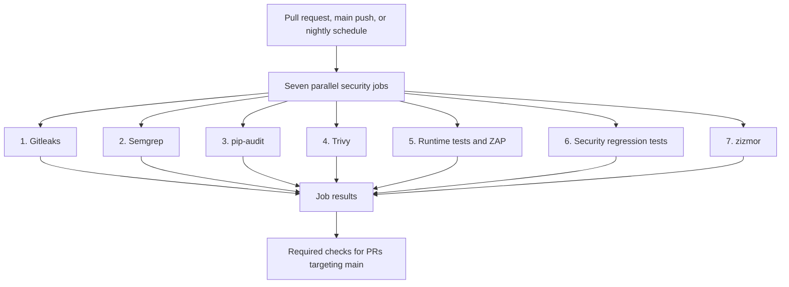

# SuperSafeCode

A DevSecOps portfolio project applying QA and test-automation methods to security
assurance. A small Flask/SQLite notes API is protected by seven GitHub Actions
gates, with deliberately failing cases used to check that controls detect the
weaknesses they are intended to cover.

The project follows vulnerabilities from detection through remediation and
regression testing, including a SAST coverage gap, container risk decisions,
and hardening of the pipeline itself. It is intended for local and CI use.

**Completion snapshot — 19 October 2026:** all seven gates passed on `main` in
[run 39307160136](https://github.com/Yu2uu/SuperSafeCode/actions/runs/39307160136)
at commit `cd635acac40f55de30d565d9056d406709576199`, following
[PR #7](https://github.com/Yu2uu/SuperSafeCode/pull/7). At that checkpoint, an
active ruleset required a PR, all seven checks, and an up-to-date branch.
See [branch protection](docs/branch-protection.md) for the settings and verification details.

## Pipeline



| Gate | Security question | Implementation or evidence |
| --- | --- | --- |
| 1 — Gitleaks | Does Git history contain credentials outside the recorded exception? | [Workflow](.github/workflows/security.yml), [configuration](.gitleaks.toml) |
| 2 — Semgrep | Does application source contain patterns covered by the selected rules? | [SAST coverage gap and custom rule](docs/evidence/sast.md) |
| 3 — pip-audit | Do resolved Python dependencies have known vulnerabilities? | [Dependency remediation](docs/evidence/dependencies.md) |
| 4 — Trivy | Does the built image violate the container policy? | [Container hardening and exceptions](docs/evidence/container.md) |
| 5 — Runtime/ZAP | Do HTTP behavior and responses meet the selected security policy? | [Runtime evidence](docs/evidence/runtime.md) |
| 6 — Regression tests | Do the fixed application weaknesses stay fixed? | [Tests](tests/test_security.py), [deliberate regression checks](scripts/verify_security_controls.py) |
| 7 — zizmor | Does the workflow violate the selected workflow-security policy? | [Hardening evidence and failure proofs](docs/evidence/pipeline.md) |

## What the investigation showed

- **A scanner can miss an intentionally vulnerable pattern.** The selected
  Semgrep packs reported Flask configuration issues but missed the interpolated
  SQLite query. A tested custom rule detected that pattern; parameterized SQL
  fixed it, and behavioral tests check for regression.
- **Authentication needs explicit requirements.** Reading notes initially
  bypassed the API-key check. Tests now require authentication for both reads
  and writes, through Flask and over HTTP against the container.
- **A smaller image helps, but does not settle applicability.** A recorded
  comparison reduced findings from 649 to 63. Non-root execution, package
  updates, removal of unused entry points, and documented exceptions addressed
  separate parts of the risk. Counts are package/advisory findings, not a count
  of exploitable vulnerabilities.
- **Exceptions need a lifecycle.** Two exceptions expired and three HIGH
  package findings blocked a later scan. Renewal followed advisory review and
  successful component-absence assertions. Passing includes accepted residual
  risk; it is not a claim that every installed package is patched.
- **The pipeline needs its own security checks.** The original workflow produced
  17 zizmor findings. SHA/digest pins, narrower permissions, checkout credential
  handling, and concurrency controls brought the configured audit to zero.
  Deliberate unsafe variants verify that Gate 7 detects regressions.

## Run locally on Windows

Prerequisite: Python 3.12. From the repository root:

```powershell
python -m venv .venv
.\.venv\Scripts\python.exe -m pip install -r requirements.txt
$env:NOTES_API_KEY = "local-demo-only"
.\.venv\Scripts\python.exe -m flask --app app.main run --host 127.0.0.1 --port 8000
```

Use the development server only for local practice. `/healthz` is public;
`POST /notes` and `GET /notes/<id>` require `X-API-Key`. Creating a note requires
a JSON object with nonempty string `owner` and `body` fields. The shared key
grants access to all notes. SQLite defaults to `notes.db`; set `NOTES_DB_PATH`
to use another path. The container runs Gunicorn on port 8000 as a non-root user.

## Run security tests

```powershell
.\.venv\Scripts\python.exe -m unittest discover -s tests -v
.\.venv\Scripts\python.exe scripts/verify_security_controls.py
```

The first command uses an isolated temporary database. The second proves that
selected tests reject deliberately reintroduced weaknesses.
CI also runs the tests over HTTP against a disposable container.

To run the workflow audit and its negative controls locally:

```powershell
.\.venv\Scripts\python.exe -m pip install --require-hashes --only-binary=:all: -r tools/requirements.txt
.\.venv\Scripts\zizmor.exe --offline --persona pedantic --min-severity low --strict-collection --no-config .github/
.\.venv\Scripts\python.exe scripts/verify_workflow_gate.py
```

Container and ZAP commands are recorded in the workflow and run on GitHub-hosted
Linux runners. Local execution of those checks requires Docker.

## Scope and maintenance

- The API uses a shared key, not per-user authorization. It is a portfolio
  service, not a production deployment.
- ZAP runs a baseline passive scan with a deliberately limited blocking policy;
  it does not establish comprehensive API or business-logic coverage.
- The historical demo-credential allowlist covers one entire commit. Other
  credentials in that same commit would also be excluded; the configuration is
  not described as an individual-secret exception.
- Trivy exceptions are scoped and time-limited. Six expire on **5 November 2026**
  and two on **17 November 2026**; review them and retain the runtime assertions.
- Dependabot proposes updates weekly. Scanner images embedded in shell commands
  require manual updates. Pins improve control of selected inputs; package
  repositories, registry rules, and vulnerability databases still change.

The linked run is a dated completion snapshot. Future advisory findings or
dependency-update PR failures are maintenance work and should be reviewed before
merging those updates.
